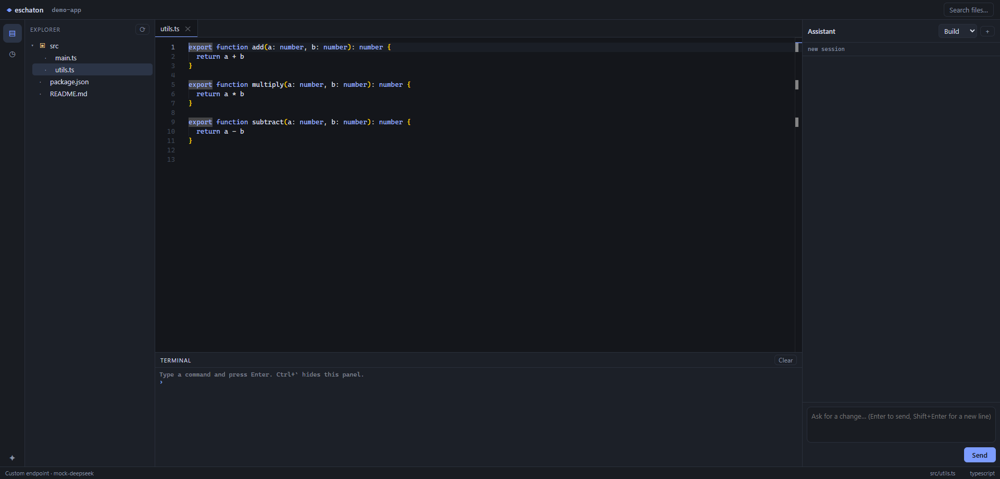

# Eschaton

A light IDE that runs in your browser and ships with a coding agent.

It is not a VS Code fork. The editor is Monaco, the same component VS Code uses, wrapped in a
small local server with a file tree, tabs, a terminal and a chat panel that can read and edit
your project. The whole thing is a few megabytes and starts in a second.



## Install

```bash
npm install -g eschaton-code
```

Requires Node.js 20 or newer.

## Run

```bash
cd ~/my-project
eschaton
```

That starts a server on `http://127.0.0.1:4123` and opens it in your browser. Everything runs on
your machine; there is no account and no hosted service.

```
eschaton --port 5000      # another port
eschaton --no-open        # do not open a browser
eschaton chat             # terminal interface instead of the IDE
```

Stop the server with `Ctrl+C`.

## Connect a model

Either a hosted provider with your own key:

```bash
eschaton login openrouter sk-or-...
eschaton login deepseek sk-...
eschaton login groq gsk_...
```

or a local server, which needs no key:

```bash
ollama pull deepseek-r1:7b
```

Ollama (`127.0.0.1:11434`) and LM Studio (`127.0.0.1:1234`) are detected at startup. Run
`eschaton doctor` to see what is available.

## Inside the editor

- **Explorer**: the workspace tree, folders expand in place.
- **Tabs**: click a file to open it, the dot means unsaved changes.
- **Terminal**: runs shell commands in the workspace and streams the output.
- **Assistant**: chat with the agent. It reads files, edits them and runs commands, showing a
  diff before a change and asking for approval.

| Shortcut | Action |
| --- | --- |
| `Ctrl+P` | Quick open a file |
| `Ctrl+S` | Save |
| `Ctrl+`` ` | Toggle the terminal |
| `Ctrl+I` | Focus the assistant |

Modes change what the agent is allowed to do:

- **Build** edits files and runs commands.
- **Plan** and **Review** are read-only.
- **Fast** answers with as few tool calls as possible.

Every conversation is saved under `~/.eschaton/sessions` and appears in the Sessions view.

## How it works

```
src/cli.ts              commands, flags, startup
src/ide/server.ts       local HTTP server, file API, SSE streams, approvals
src/ide/web/            editor UI (Monaco + xterm)
src/llm/providers.ts    provider list, local discovery, streaming, failover
src/agent/coding-agent.ts  ReAct loop and tools
src/session.ts          session storage
```

The server binds to `127.0.0.1` only and refuses paths outside the workspace. Commands and file
writes requested by the model are sent to the browser as an approval request before they run.

## Development

```bash
bun install
bun run dev        # build once, then start the server
bun test
bun run typecheck
bun run build
```

`bun run build` writes the CLI bundle to `dist/eschaton.js` and the UI to `dist/public`, including
Monaco from `node_modules`. The built files are committed so a git install works without a build
step.

## Limitations

- The terminal runs one command at a time; there is no interactive PTY, so full-screen programs
  like `vim` or `htop` do not work there.
- One workspace per server, no multi-root or remote editing.
- No git UI yet; use the terminal.
- The agent sees the conversation and the files it reads, not the whole repository.

## License

Apache License 2.0. See [LICENSE](LICENSE).
