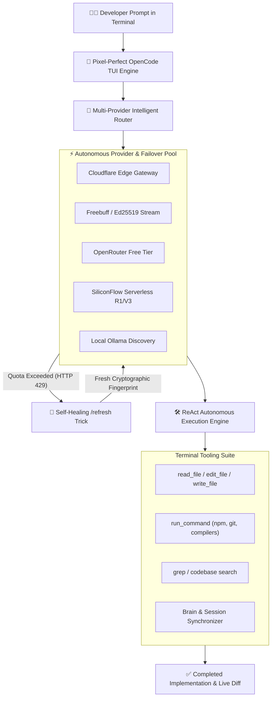

<div align="center">

# ⚡ ESCHATON CODE

### *Autonomous Terminal AI Coding Agent & Multi-Provider ReAct Engine*

<br/>

```text
███████╗███████╗ ██████╗██╗  ██╗ █████╗ ████████╗ ██████╗ ███╗   ██╗     ██████╗ ██████╗ ██████╗ ███████╗
██╔════╝██╔════╝██╔════╝██║  ██║██╔══██╗╚══██╔══╝██╔═══██╗████╗  ██║    ██╔════╝██╔═══██╗██╔══██╗██╔════╝
█████╗  ███████╗██║     ███████║███████║   ██║   ██║   ██║██╔██╗ ██║    ██║     ██║   ██║██║  ██║█████╗  
██╔══╝  ╚════██║██║     ██╔══██║██╔══██║   ██║   ██║   ██║██║╚██╗██║    ██║     ██║   ██║██║  ██║██╔══╝  
███████╗███████║╚██████╗██║  ██║██║  ██║   ██║   ╚██████╔╝██║ ╚████║    ╚██████╗╚██████╔╝██████╔╝███████╗
╚══════╝╚══════╝ ╚═════╝╚═╝  ╚═╝╚═╝  ╚═╝   ╚═╝    ╚═════╝ ╚═╝  ╚═══╝     ╚═════╝ ╚═════╝ ╚═════╝ ╚══════╝
```

<br/>

**Pixel-Perfect OpenCode TUI • Multi-Provider DeepSeek Pool • Autonomous Failover & Unlimited Session Trick**  
*Built for terminal power users, researchers, and engineers demanding sovereign, unmetered AI assistance.*

<br/>

[](https://github.com/Tarikdxd/Eschaton-Code/releases/latest)
[](https://github.com/users/Tarikdxd/packages/npm/package/eschaton-code)
[](https://github.com/Tarikdxd/Eschaton-Code)
[](LICENSE)
[](https://github.com/Tarikdxd/Eschaton-Code)

---

</div>

<br/>

## 🎯 What is Eschaton Code?

**Eschaton Code** is a high-performance, standalone terminal coding agent designed to give you the exact sleek look and feel of **OpenCode**, backed by an intelligent multi-provider engine. 

Instead of being tied to a single cloud provider or running out of tokens mid-task, Eschaton Code distributes queries across a resilient failover pool of free **DeepSeek-V3**, **DeepSeek-R1**, **Flash**, and serverless edge endpoints. When quotas are exhausted, its automated `/refresh` mechanism rotates cryptographic identities on the fly—keeping your coding flow 100% uninterrupted.

---

## ⚡ Quick Start & Global Installation

### Option 1: Direct Global npm Install (Recommended)
You can install and run Eschaton Code globally in a single line:

```bash
npm install -g https://github.com/Tarikdxd/Eschaton-Code/releases/download/v1.3.0/tarikdxd-eschaton-code-1.3.0.tgz --force
```

*(Or via GitHub Packages registry: `npm install -g @tarikdxd/eschaton-code`)*

### Option 2: Run from Local Source
```bash
git clone https://github.com/Tarikdxd/Eschaton-Code.git
cd Eschaton-Code
npm install
npm run build
npm install -g .
```

### Launching the Agent
Open any terminal in your project directory and type:

```bash
eschaton
```
*(Aliases supported out of the box: `opencode`, `freebuff`)*

---

## 💎 Core Architecture & Capabilities



---

## 🌟 Key Features

### 🎨 1. Pixel-Perfect OpenCode TUI
- **Shaded Block Typography:** Beautifully centered ASCII and block logo with anti-aliasing.
- **Electric Blue Input Accent (`▌`):** Sleek, dark container interface matching the modern OpenCode aesthetic.
- **Dynamic Mode Switching (`Tab`):**
  - <kbd>Build</kbd> *(Cyan)* — Autonomous multi-file edits, compiler fixes, and test runs.
  - <kbd>Plan</kbd> *(Green)* — High-level technical architecture and task breakdown.
  - <kbd>Review</kbd> *(Yellow)* — Static analysis, bug auditing, and vulnerability scans.
  - <kbd>Fast</kbd> *(Magenta)* — Zero-latency single-turn Q&A and code snippets.

### ⚡ 2. Resilient Multi-Provider DeepSeek Pool
- **Zero Configuration:** Ready out of the box without requiring paid OpenAI or Claude keys.
- **Intelligent Failover:** Seamlessly shifts between Cloudflare Edge, Freebuff streams, OpenRouter Free endpoints, and local Ollama if any service encounters rate limits.

### 🔄 3. The Autonomous `/refresh` Trick (Unlimited Quotas)
- Rotates device fingerprints, generates a fresh Ed25519 keypair, and requests a new session admission token.
- Automatically triggers in the background if providers report quota exhaustion, ensuring zero downtime.

### 🛠️ 4. Full ReAct Tooling Suite
- Autonomous file reading, exact substring diff replacements, project directory indexing, and native terminal execution (Git, compilers, test runners).

---

## ⌨️ Command Palette

| Command | Keybinding | Purpose |
|:---|:---:|:---|
| `/refresh` | - | Rotates hardware tokens & restores 100% quota |
| `/model` | - | Interactively switch active DeepSeek model (V3, R1, Flash) |
| `/auth` | - | Inspect current session and Google Antigravity bindings |
| `/clear` | <kbd>Ctrl+L</kbd> | Clear screen buffer and re-center banner |
| `/exit` | <kbd>Ctrl+C</kbd> | Cleanly exit terminal session |
| Mode Switch | <kbd>Tab</kbd> | Cycle between **Build** ➔ **Plan** ➔ **Review** ➔ **Fast** |

---

## 🤝 Contributing & Community

Contributions, issue reports, and pull requests are welcome! Feel free to check the [Open Issues](https://github.com/Tarikdxd/Eschaton-Code/issues) or submit your improvements.

1. Fork the Project
2. Create your Feature Branch (`git checkout -b feat/AmazingFeature`)
3. Commit your Changes (`git commit -m 'feat: Add some AmazingFeature'`)
4. Push to the Branch (`git push origin feat/AmazingFeature`)
5. Open a Pull Request

---

## 📄 License

Distributed under the **Apache License 2.0**. See [`LICENSE`](LICENSE) for more information.

<div align="center">

**Developed with ⚡ by [Tarık Tozlu (@Tarikdxd)](https://github.com/Tarikdxd)**

</div>
