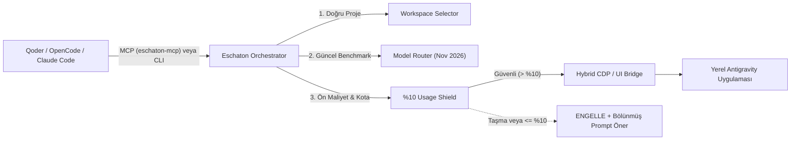

<div align="center">

<br />

# 𝔈𝔰𝔠𝔥𝔞𝔱𝔬𝔫 𝔄𝔤𝔢𝔫𝔱

**Evrensel Antigravity Co-Agent Köprüsü & %10 Kullanım Kalkanlı Orkestratör**

*Qoder, OpenCode, Claude Code ve Cursor ajanlarının bilgisayarındaki yerel **Antigravity** uygulamasına doğrudan bağlanmasını, doğru projeyi seçmesini, güncel benchmarklara göre en iyi modeli atamasını ve kotanı asla **%10** altına düşürmeden görev devretmesini sağlar.*

<br />

[](https://tarikdxd.github.io/Eschaton-Agent/)
[](https://github.com/Tarikdxd/Eschaton-Agent/releases/tag/v2.0.0)
[](https://github.com/Tarikdxd/Eschaton-Agent/blob/main/eschaton/mcp/server.py)
[](https://github.com/Tarikdxd/Eschaton-Agent/blob/main/LICENSE)

<br />

[Canlı Web Sitesi & %10 Kalkan Simülatörü](https://tarikdxd.github.io/Eschaton-Agent/) · [Ajan Kurulum Protokolü (`AGENTS.md`)](https://github.com/Tarikdxd/Eschaton-Agent/blob/main/AGENTS.md) · [MCP Araçları](#mcp-araçları) · [CLI Komutları](#cli-komutları)

</div>

---

## Tek Satırda Kullanım (Qoder / OpenCode / Claude Code / Cursor)

Kullandığınız yapay zeka ajanına yalnızca bu reponun linkini verip şu cümleyi yazmanız yeterlidir:

```text
https://github.com/Tarikdxd/Eschaton-Agent reposunu kullanarak bilgisayarımdaki Antigravity'ye bağlan ve yardımcı ajan olarak kullan.
```

Ajan repo kökündeki [`AGENTS.md`](./AGENTS.md), [`CLAUDE.md`](./CLAUDE.md) ve [`SKILL.md`](./SKILL.md) dosyalarını okuyarak kurulumu ve `eschaton-mcp` bağlantısını **otomatik** tamamlar.

---

## Mimari



---

## Dört Çekirdek Katman

| Katman | Ne Yapar? |
| --- | --- |
| **01 · Hibrit Electron CDP + UI Köprüsü** | Birincil olarak Antigravity'nin Electron CDP/DOM portu üzerinden fareyi meşgul etmeden arka planda çalışır; port kapalıysa OS UI otomasyonu yedeğine geçer. |
| **02 · Akıllı Proje / Workspace Seçici** | Dış ajanın çalıştığı dizini, yerel git repolarını ve açık Antigravity pencerelerini tarayarak doğru projeyi eşleştirir, odaklar veya açar. |
| **03 · Canlı Benchmark Model Seçici** | [`antigravity.google/docs/models`](https://antigravity.google/docs/models/), **SWE-bench Verified**, **Aider Polyglot** ve **LiveCodeBench** verilerini senkronize ederek her prompta en uygun güncel modeli seçer. |
| **04 · %10 Korumalı Token & Usage Kalkanı** | Gönderim öncesi `Prompt + Bağlam + Beklenen Çıktı` token maliyetini hesaplar. Taşma veya **%10** sınırını aşma riski varsa promptu **kesinlikle göndermez**, bölünmüş/sıkıştırılmış alternatif önerir. |

---

## Kasım 2026 Model Yönlendirme Havuzu

| Sağlayıcı | Model | Rol / Güçlü Alan | Maliyet Çarpanı |
| --- | --- | --- | --- |
| **Google Antigravity** | `gemini-4-neon` | Varsayılan Frontier · UI/UX, çoklu dosya mimarisi, `Extra (xhigh)` akıl yürütme | `1.15x` |
| **Google Antigravity** | `gemini-4-carbon` | Ultra · Ağır sistem tasarımı ve çoklu-repo göçleri | `1.60x` |
| **Google Antigravity** | `gemini-4-argon` | Uzun çıktılı yüksek akıl yürütme görevleri | `1.10x` |
| **Google Antigravity** | `gemini-4-hydrogen` | Hızlı Executor · Günlük kodlama, test üretimi, düşük maliyet | `0.45x` |
| **Google Antigravity** | `orchestrator` | Planner (`Neon`/`Carbon`) + Executor (`Hydrogen`) hibrit ikilisi | `0.85x` |
| **Google Antigravity** | `gemini-3.8-flash` | **Ekonomi Kalkanı** · Kota %10–%15 bandına indiğinde otomatik devreye girer | `0.28x` |
| **Anthropic** | `claude-opus-5.5` | Uzun soluklu ajantik kodlama ve derin kök-neden hata ayıklama (`1M` bağlam) | `1.80x` |
| **Anthropic** | `claude-sonnet-5.5` | Hız ve zeka dengesinde SWE-bench & Aider Polyglot kodlama lideri (`1M` bağlam) | `1.10x` |
| **Anthropic** | `claude-fable-5.2` | En yüksek seviye uzun ufuklu akıl yürütme (`1M` bağlam) | `2.60x` |
| **OpenAI** | `gpt-6.2-astra` | Karmaşık algoritmik akıl yürütme ve doğrulama | `1.60x` |

---

## %10 Usage Kalkanı Nasıl Çalışır?

1. **Güvenli Bölge (`> %15`):** Prompt + bağlam + beklenen çıktı/thinking tokenı hesaplanır ve seçilen benchmarklı modelle gönderilir.
2. **Ekonomi Modu (`%10 < Kalan <= %15`):** Kalkan otomatik olarak `gemini-3.8-flash` modeline geçer; normal model %10 sınırını aşacaksa yine otomatik ekonomi modeline düşürür.
3. **Kesin Kilit (`<= %10.0` veya Taşma Riski):** Prompt **Antigravity'ye gönderilmez** (`allowed: false`). Dış ajana `BLOCKED_FLOOR_10_PERCENT` veya `BLOCKED_PROJECTED_BREACH` koduyla birlikte sıkıştırılmış/parçalanmış alt görev önerileri döndürülür.

> Kalkan davranışını canlı test etmek için: **[tarikdxd.github.io/Eschaton-Agent/#shield-simulator](https://tarikdxd.github.io/Eschaton-Agent/#shield-simulator)**

---

## Kurulum & Bağlantı

```bash
git clone https://github.com/Tarikdxd/Eschaton-Agent.git
cd Eschaton-Agent
pip install -e .
```

### MCP Sunucusu (`eschaton-mcp`)

Qoder, OpenCode, Claude Code veya Cursor yapılandırmanıza ekleyin:

```json
{
  "mcpServers": {
    "eschaton-antigravity": {
      "command": "eschaton-mcp",
      "args": []
    }
  }
}
```

### MCP Araçları

| Araç | Açıklama |
| --- | --- |
| `antigravity_status` | CDP / UI bağlantı durumunu, açık projeleri, modelleri ve kalan % kotayı okur. |
| `antigravity_select_project` | Bilgisayardaki doğru proje dizinini bulup Antigravity ile eşleştirir veya açar. |
| `antigravity_select_best_model` | Resmi Antigravity Docs, SWE-bench, Aider ve LiveCodeBench verilerine göre en iyi modeli seçer. |
| `antigravity_check_usage_shield` | Gönderim öncesi token & %10 koruma kalkanı doğrulaması yapar. |
| `antigravity_delegate_task` | Proje seçimi + model seçimi + %10 kalkanı + uzman rol (`co_architect`, `code_implementer`, `deep_debugger`, `ui_specialist`, `reviewer_tester`, `quick_helper`) ile görevi iletir. |

### CLI Komutları

```bash
eschaton connect                                           # Antigravity hibrit köprüsünü kurar
eschaton status                                            # Bağlantı, pencere ve kalkan durumunu gösterir
eschaton usage                                             # Canlı kullanım % ve 10% koruma sınırını raporlar
eschaton research-model "Auth middleware refactor et"      # Görev için en iyi benchmarklı modeli seçer
eschaton select-project /path/to/project --open            # Projeyi Antigravity'de seçer/açar
eschaton delegate "Race condition hatasını çöz" \
  --project "$(pwd)" --role deep_debugger                  # Tam orkestrasyon ile görev devreder
eschaton mcp                                               # JSON-RPC stdio MCP sunucusunu başlatır
```

---

## Testler

```bash
pip install -e ".[dev]"
pytest -v
```

<div align="center">
<br />
<sub>MIT License · <a href="https://tarikdxd.github.io/Eschaton-Agent/">tarikdxd.github.io/Eschaton-Agent</a></sub>
</div>
